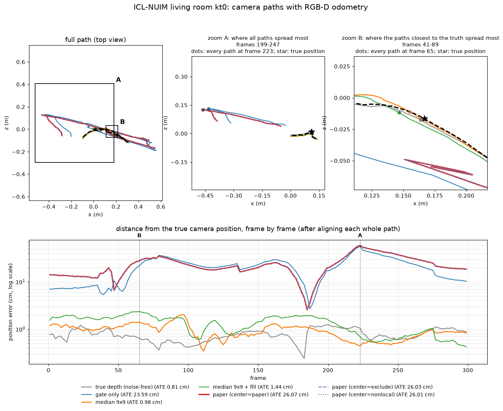
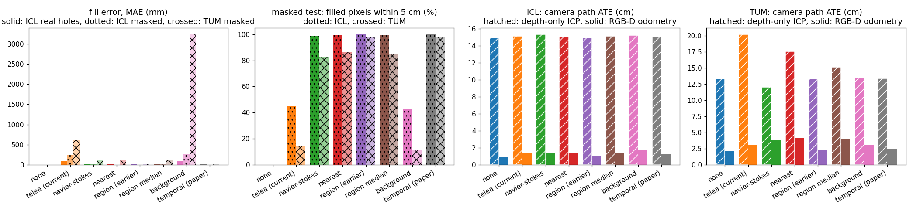

# Kinect Lite: depth denoising for camera tracking

Kinect-style depth cameras give a distance for every pixel, but two kinds of error get in the way:
**spikes** (pixels with a wildly wrong distance) and **holes** (pixels with no distance at all). This project
cleans the depth images and measures whether the cleaning makes **camera tracking** more accurate.

We compare two cleaners:

| method | code | how it works | time for 450 frames |
|---|---|---|---|
| **ours: 9×9 median** | `src/clean.py` | depth below 0.4 m becomes a hole; then each pixel is replaced by the median of the measured pixels in its 9×9 window. One frame at a time. | under 1 min |
| **paper: Fu et al. (2012)** | `src/paper_pipeline.py` | predicts hole values from the 2 frames before and after (block matching), then smooths with a spatial-temporal bilateral filter (ST-DNBL). | about 26 min |

Each cleaned sequence is fed to two trackers, and the estimated camera path is compared with the true one:
- **depth-only ICP**: aligns consecutive 3D point clouds (Open3D point-to-plane ICP). Uses depth only.
- **RGB-D odometry**: aligns consecutive frames using colour and depth together (Open3D hybrid odometry).

> **Neither cleaner uses the colour image.** Fu et al. is a depth-only method, and so is our median. The RGB image
> is used only by the RGB-D tracker, *after* cleaning, and it is the same unmodified image for every method. So the
> only thing that changes between rows of the results is the cleaned depth. We test with both trackers because real
> systems use both kinds, and the best cleaner turns out to be different for each.

```
raw depth ──► cleaner (none / median / paper) ──► cleaned depth ──► depth-only ICP ──► camera path vs. true path
                                                  cleaned depth ─┐
RGB image (unchanged, same for every method) ────────────────────┴► RGB-D odometry ──► camera path vs. true path
```

**All results (tables + figures only):** [`results.pdf`](results.pdf) (source: [`report/results.tex`](report/results.tex)).
Full write-up with explanations: [`report/report.tex`](report/report.tex).


## Data and metrics

| dataset | what it is | frames used | ground truth |
|---|---|---|---|
| **ICL-NUIM** living room kt0 | synthetic, with simulated Kinect noise | 1–300, every 2nd tracked (150) | true depth **and** true camera path |
| **TUM RGB-D** fr3 long_office_household | real Asus Xtion sensor | 0–299, every 2nd tracked (150) | true camera path (motion capture); no true depth |

| metric | meaning | good value |
|---|---|---|
| **MAE** (mm) | average per-pixel distance between cleaned and true depth | lower |
| **RMSE** (mm) | like MAE, but large misses count more. RMSE much higher than MAE means spikes remain | lower |
| **within 1 cm** (%) | share of pixels less than 1 cm from the true depth | higher |
| **ATE** (cm) | average distance between estimated and true camera positions over the whole path: overall drift | lower |
| **RPE** (mm) | error of each single step between two tracked frames: local accuracy, does not accumulate | lower |

For scale: on ICL the camera moves 6.5 mm per tracked step (0.97 m total), on TUM 20.7 mm (3.09 m total).


## Results

### 1. Depth accuracy (ICL, against the true depth)

| method | MAE (mm) | RMSE (mm) | median error (mm) | within 1 cm |
|---|---|---|---|---|
| no cleaning (input) | 39.2 | 187.5 | 13.3 | 42.2 % |
| **median 9×9 (ours)** | **18.8** | **55.4** | **12.3** | **44.7 %** |
| paper (Fu et al.) | 37.7 | 186.0 | 13.4 | 33.7 % |

**Our median halves the depth error; the paper barely changes it.** The ICL noise is dominated by spikes, which
is why the input's RMSE (187 mm) is almost 5× its MAE. A median simply votes spikes out (RMSE drops to 55 mm), and
it improves every one of the 300 frames. The paper's bilateral filter weights each neighbour by how similar its
depth is to the centre pixel, so a spike only averages with itself and survives (RMSE stays at 186 mm). The
paper's output is smoother, but its error grows with distance, so fewer pixels land within 1 cm.


*One ICL frame: cleaned depth (top) and error against the true depth (bottom, brighter = worse). The median removes
the speckled spikes; the paper's output keeps them.*

### 2. Camera tracking

ATE in cm / RPE in mm, 150 tracked frames. Bold = best per column (excluding the true-depth reference).

| method | ICL, depth-only ICP | ICL, RGB-D odometry | TUM, depth-only ICP | TUM, RGB-D odometry |
|---|---|---|---|---|
| *true depth (best possible)* | *0.19 / 0.07* | *0.81 / 2.18* | – | – |
| no cleaning (input) | 17.07 / 14.43 | 23.59 / 24.20 | 13.97 / 11.69 | 2.14 / **5.61** |
| **median 9×9 (ours)** | 14.94 / 11.78 | **0.98 / 1.59** | 13.32 / 10.86 | **2.08** / 5.69 |
| paper (Fu et al.) | **0.95 / 2.02** | 26.0 / 21.76 | **3.31 / 4.37** | 2.10 / 5.80 |

**Depth-only ICP: the paper wins clearly** (drift 0.95 vs 14.94 cm on ICL, 3.31 vs 13.32 cm on TUM, i.e. 4–16×
less). Point-to-plane ICP throws away far-off point matches, so the spikes the paper leaves cost little, but it
relies on surface normals. The paper's smoothing gives clean surfaces and good normals; the median leaves the
sensor's striped error pattern, which biases every alignment step slightly and adds up to drift. On ICL the median
barely improves on the raw input here (14.94 vs 17.07 cm).

**RGB-D odometry: our median wins.** On ICL it reaches 0.98 cm, close to the 0.81 cm that the true depth gives,
while the paper fails (26.0 cm, worse than no cleaning). RGB-D odometry projects every pixel using its depth, so
each surviving spike drags the alignment: with the paper's output, 49 of 149 steps are off by more than 20 mm,
with the median none. On TUM all methods are within 0.06 cm of each other (2.08–2.14 cm): the real sensor's noise is
less spike-heavy than ICL's simulated noise, so cleaning matters less there.

**The paper's ambiguous step does not matter.** Its hole-prediction equation can be read three ways (`paper`,
`exclude`, `nonlocal` in the code). All three give results within 0.06 cm, because holes are only about 1 % of
the pixels.



*ICL, RGB-D odometry: estimated camera paths seen from above (top) and the position error per frame (bottom, log
scale). The median (orange) stays close to the true path; the paper (red) drifts with the uncleaned input (blue).*

### 3. Should the holes be filled?

After the median about 1 % of ICL pixels and 16 % of TUM pixels are holes. We tested 8 ways to fill them
(`experiments/hole_filling/`). *Fill error* is measured against the true depth at ICL's real holes; tracking is
ATE in cm.

| fill method | fill error (mm) | ICL RGB-D | TUM depth-only ICP | TUM RGB-D | time per frame |
|---|---|---|---|---|---|
| **none (keep holes)** | – | **0.98** | 13.33 | **2.08** | 0 ms |
| Telea inpainting (OpenCV) | 87.0 | 1.44 | 20.21 | 3.13 | 210 ms |
| Navier–Stokes inpainting (OpenCV) | 22.5 | 1.46 | **12.03** | 3.89 | 224 ms |
| nearest measured pixel | 22.3 | 1.43 | 17.54 | 4.16 | 50 ms |
| region growing, small holes only | 15.5 | 1.01 | 13.32 | 2.23 | 52 ms |
| region growing, median of neighbours | 22.5 | 1.43 | 15.14 | 4.08 | 386 ms |
| background (far side of the hole) | 83.1 | 1.80 | 13.51 | 3.14 | 40 ms |
| temporal (paper's prediction, frames t±2) | **12.2** | 1.24 | 13.37 | 2.51 | 7.9 s |

**No fill improves RGB-D odometry, on either dataset.** A filled pixel is a guess, and the trackers do better
ignoring a missing pixel than using a wrong one. The fills that change the least (small holes only, temporal) hurt
the least. Telea inpainting, the obvious first choice, is among the least accurate (87 mm), because it blends
the near and far sides of a depth edge. The one gain, Navier–Stokes on TUM depth-only ICP (12.03 vs 13.33 cm), does
not hold on ICL (15.36 vs 14.94 cm), so we do not count it.




## Conclusion

| if your system uses... | use | why |
|---|---|---|
| **RGB-D odometry** (colour + depth) | **9×9 median, no hole filling** | best depth accuracy (error halved), best or equal-best tracking, under a minute for 450 frames |
| **depth-only ICP** | the paper's pipeline | 4–16× less drift thanks to its smooth surfaces, but about 26 min for 450 frames |
| filled depth for display | median + Navier–Stokes or nearest | about 4× more accurate than Telea; do not feed it to the tracker |


## Common questions

All six cleaner + tracker combinations, ATE in cm, sorted by the real-sensor (TUM) result:

| cleaner | tracker | TUM (real) | ICL (synthetic) |
|---|---|---|---|
| **median 9×9 (ours)** | RGB-D odometry | **2.08** | 0.98 |
| paper (Fu et al.) | RGB-D odometry | 2.10 | 26.07 |
| no cleaning | RGB-D odometry | 2.14 | 23.59 |
| paper (Fu et al.) | depth-only ICP | 3.33 | **0.95** |
| median 9×9 (ours) | depth-only ICP | 13.32 | 14.94 |
| no cleaning | depth-only ICP | 13.97 | 17.07 |

- **Does either cleaner use the RGB image?** No. Both are depth-only. The RGB image goes unchanged to the RGB-D
  tracker, the same for every method, so only the cleaned depth differs.
- **Then why test with an RGB-D tracker?** Real systems use both kinds of tracker, and the best cleaner flips between
  them. With only ICP we'd conclude "the median barely helps"; with only RGB-D, "the paper makes things worse". Both
  are true, each for its own tracker.
- **Isn't depth alone enough?** Only with very clean depth. With ICL's perfect depth, ICP is best (0.19 cm). On real
  TUM data the best depth-only result is 3.33 cm and needs the 26-minute pipeline; RGB-D gets 2.08 cm with the median.
  Depth-only also can't measure motion along flat walls or floors, and TUM is still 16 % holes after cleaning.
- **Isn't the depth-only error lower than ours?** Paper + ICP vs. median + RGB-D: 0.95 vs 0.98 cm on ICL (a tie,
  within noise) and 3.33 vs 2.08 cm on TUM (RGB-D wins). But median + depth-only ICP is poor (13–15 cm): the median
  doesn't suit a depth-only tracker.
- **RGB-D "ICP"?** No: RGB-D odometry is not ICP. ICP aligns 3D points using depth only; RGB-D odometry aligns the
  images using colour and depth.

Full answers: section 4 of the write-up, [`report/report.tex`](report/report.tex).


## Run it

```
pip install -r requirements.txt                              # Python 3.12
python src/icl_compare.py --start 1 --frames 300 --step 2   # ICL: depth error + both trackers
python src/tum_compare.py --start 0 --frames 300 --step 2   # TUM: both trackers (slow; ran on Kaggle, see kaggle/PUSH.md)
python experiments/hole_filling/compare_fills.py --frames 300 --step 2   # hole-filling comparison (slow)
cd report; pdflatex results.tex; pdflatex results.tex        # rebuild results.pdf, then copy it to ../results.pdf
```

Datasets are not included. Download them into this folder:
[ICL-NUIM](https://www.doc.ic.ac.uk/~ahanda/VaFRIC/iclnuim.html) living room kt0 → `ICL NUIM/`, and
[TUM RGB-D](https://cvg.cit.tum.de/data/datasets/rgbd-dataset) fr3 long_office_household → `RGB TUM/`.
All numbers above are in `src/results/icl_compare.txt`, `src/results/tum_compare.txt` and
`experiments/hole_filling/results/fills.txt`.


## Folder layout

| folder | contents |
|---|---|
| `src/` | the code: `clean.py` (ours), `paper_pipeline.py` (the paper), `icl_compare.py` / `tum_compare.py` (the experiments), `plot_paths.py` (path figures); `results/` holds all numbers and figures |
| `experiments/` | the hole-filling comparison, the earlier filter study that chose the median, and our first versions of the paper pipeline |
| `kaggle/` | scripts for the slow runs on Kaggle |
| `report/` | LaTeX sources: `results.tex` (builds `results.pdf`) and `report.tex` (full write-up) |
| `results.pdf` | all results: tables and figures, each table labelled with its source file |


## Credits

J. Fu, S. Wang, Y. Lu, S. Li, W. Zeng, "Kinect-Like Depth Denoising," ISCAS 2012. Datasets: ICL-NUIM (Handa et
al., 2014), TUM RGB-D (Sturm et al., 2012). Built with Open3D, OpenCV, NumPy, SciPy and Matplotlib.
