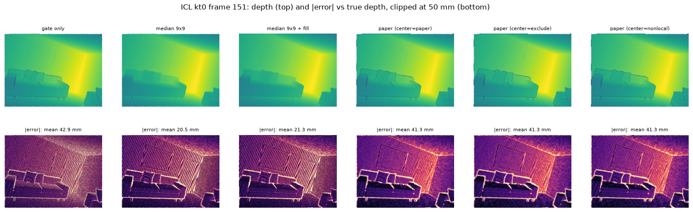
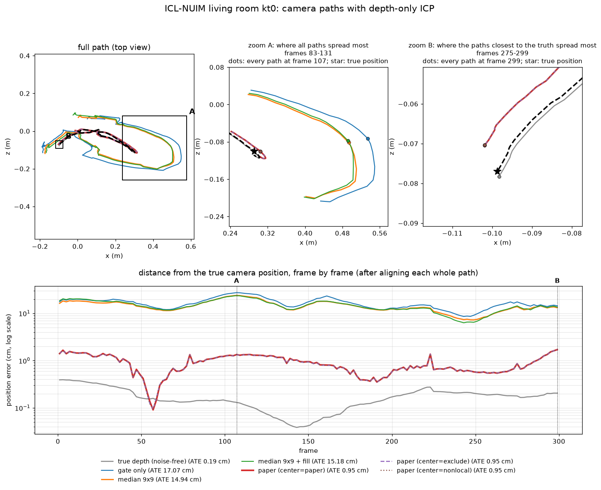

# Kinect Lite: depth denoising for camera tracking

Kinect-style depth cameras give a distance for every pixel, but two kinds of error get in the way:
**spikes** (pixels with a wildly wrong distance) and **holes** (pixels with no distance at all). This project
cleans the depth images and measures whether the cleaning makes **depth-only ICP camera tracking** more accurate.

## At a glance

- **Depth accuracy:** a simple 9×9 median halves the depth error (MAE 39 to 19 mm on ICL); the paper's filter barely changes it.
- **Camera tracking:** the paper's pipeline gives 4–16× less drift than the raw input or our median (ATE 0.95 vs 14.94 cm on ICL, 3.33 vs 13.32 cm on TUM).
- **Takeaway:** a cleaner that removes more depth error is not automatically better for ICP.

## The two cleaners

| method | code | how it works | time for 450 frames |
|---|---|---|---|
| **ours: 9×9 median** | `src/clean.py` | depth below 0.4 m becomes a hole; then each pixel is replaced by the median of the measured pixels in its 9×9 window. One frame at a time. | under 1 min |
| **paper: Fu et al. (2012)** | `src/paper_pipeline.py` | predicts hole values from the 2 frames before and after (block matching), then smooths with a spatial-temporal bilateral filter (ST-DNBL). | about 26 min |

Each cleaned sequence is fed to a **depth-only ICP** tracker, and the estimated camera path is compared with the true one.
The tracker aligns consecutive 3D point clouds with Open3D point-to-plane ICP (coarse to fine, voxels 4/2/1 cm, pairs
farther apart than 10/5/2 cm are dropped). It uses the depth only, so the only thing that changes between rows of the
results is the cleaned depth.
> **ICP variants:** the main results use point-to-plane ICP. Point-to-point (the SVD-based variant in the proposal), a
> robust point-to-plane and generalized ICP are compared in section 3.

```
raw depth ──► cleaner (none / median / paper) ──► cleaned depth ──► depth-only ICP ──► camera path vs. true path
```

## Data and metrics

| dataset | what it is | frames used | ground truth |
|---|---|---|---|
| **ICL-NUIM** living room kt0 | synthetic, with simulated Kinect noise | 1–300, every 2nd tracked (150) | true depth **and** true camera path |
| **TUM RGB-D** fr3 long_office_household | real Asus Xtion sensor | 0–299, every 2nd tracked (150) | true camera path (motion capture); no true depth |

| metric | meaning | good value |
|---|---|---|
| **MAE** (mm) | average per-pixel distance between cleaned and true depth | lower |
| **RMSE** (mm) | like MAE, but large misses count more. RMSE much higher than MAE means spikes remain | lower |
| **within 1 cm** (%) | share of pixels less than 1 cm from the true depth | higher |
| **ATE** (cm) | average distance between estimated and true camera positions over the whole path: overall drift | lower |
| **RPE** (mm) | error of each single step between two tracked frames: local accuracy, does not accumulate | lower |

For scale: on ICL the camera moves 6.5 mm per tracked step (0.97 m total), on TUM 20.7 mm (3.09 m total).


## Results

### 1. Depth accuracy (ICL, against the true depth)

| method | MAE (mm) | RMSE (mm) | median error (mm) | within 1 cm |
|---|---|---|---|---|
| no cleaning (input) | 39.2 | 187.5 | 13.3 | 42.2 % |
| **median 9×9 (ours)** | **18.8** | **55.4** | **12.3** | **44.7 %** |
| paper (Fu et al.) | 37.7 | 186.0 | 13.4 | 33.7 % |

**Our median halves the depth error; the paper barely changes it.** The ICL noise is dominated by spikes, which
is why the input's RMSE (187 mm) is almost 5× its MAE. A median simply votes spikes out (RMSE drops to 55 mm), and
it improves every one of the 300 frames. The paper's bilateral filter weights each neighbour by how similar its
depth is to the centre pixel, so a spike only averages with itself and survives (RMSE stays at 186 mm).



*One ICL frame: cleaned depth (top) and error against the true depth (bottom, brighter = worse). The median removes
the speckled spikes; the paper's output keeps them.*

### 2. Camera tracking with depth-only ICP

ATE in cm / RPE in mm, 150 tracked frames. Bold = best per column (excluding the true-depth reference).

| method | ICL | TUM |
|---|---|---|
| *true depth (best possible)* | *0.19 / 0.07* | – |
| no cleaning (input) | 17.07 / 14.43 | 13.97 / 11.69 |
| median 9×9 (ours) | 14.94 / 11.78 | 13.32 / 10.86 |
| **paper (Fu et al.)** | **0.95 / 2.02** | **3.33 / 4.37** |

**The paper wins clearly** (drift 0.95 vs 14.94 cm on ICL, 3.33 vs 13.32 cm on TUM, i.e. 4–16× less). The median
barely improves on the raw input (14.94 vs 17.07 cm on ICL, 13.32 vs 13.97 cm on TUM). On ICL the median's error per
step (11.78 mm) is larger than the camera's motion per step (6.5 mm), so its tracking is mostly noise.

**Depth accuracy does not predict tracking accuracy.** The paper has the *worse* per-pixel depth error (MAE 37.7 vs
18.8 mm) and still tracks about 6× better per step. ICP aligns two frames, so what matters is how well the two
cleaned frames agree with each other, not how close each is to the truth.

**The paper's ambiguous step does not matter.** Its hole-prediction equation can be read three ways (`paper`,
`exclude`, `nonlocal` in the code). All three give results within 0.06 cm, because holes are only about 1 % of
the pixels.



*ICL, depth-only ICP: estimated camera paths seen from above (top) and the position error per frame (bottom, log
scale).*

### 3. Which ICP variant?

Same cleaned depth, four ways to align it (`src/icp_variants.py`, `src/results/icp_variants.txt`). ATE in cm / RPE in mm.

| ICL | point-to-point (SVD) | **point-to-plane** | point-to-plane + Tukey loss | generalized ICP |
|---|---|---|---|---|
| true depth | 1.81 / 3.29 | 0.19 / 0.07 | **0.14 / 0.05** | – |
| no cleaning | 36.96 / 21.36 | **17.05 / 14.38** | 22.47 / 17.47 | – |
| median 9×9 | 28.50 / 19.72 | **14.94 / 11.78** | 19.24 / 14.11 | – |
| paper | 1.93 / 3.16 | **0.95 / 2.02** | 1.42 / 2.54 | – |

| TUM | point-to-point (SVD) | **point-to-plane** | point-to-plane + Tukey loss | generalized ICP |
|---|---|---|---|---|
| no cleaning | 27.24 / 14.92 | 13.97 / 11.69 | 14.31 / **11.55** | – |
| median 9×9 | 18.14 / 13.78 | 13.33 / **10.86** | **13.07** / 10.96 | 281559 (diverged) |
| paper | 5.31 / 5.21 | 3.33 / 4.37 | **3.21 / 4.23** | 14.13 / 43.42 |

- **Point-to-plane beats point-to-point in all 7 rows**, by about 2× on ICL and 1.4 to 5× on TUM. The SVD variant is not
  good enough on this data: with the median it drifts 28.5 cm on ICL, and even with *true* depth it reaches 1.81 cm
  (point-to-plane: 0.19 cm). Matched points are not the same physical spot, so point-to-point counts sliding along a
  surface as error.
- **The robust Tukey loss is no clear improvement**: slightly better on TUM, worse on ICL (19.24 vs 14.94 cm on the median).
- **Generalized ICP diverged** (non-finite poses) on every noisy sequence we could finish. It crashed the run on ICL, so
  no ICL numbers exist; on TUM it gave 281559 cm with the median and 14.13 cm with the paper. We did not tune it, so
  this means "unstable with these settings", not "bad in general".
- **The cleaner ranking does not depend on the ICP variant**: the paper beats the median under every variant that ran
  (e.g. ICL 0.95 vs 14.94 cm point-to-plane, 1.93 vs 28.50 cm point-to-point). The median never fixes tracking.

These numbers come from the log of a Kaggle run that finished all tracking except generalized ICP and then crashed at
the table step.

### 4. Why does the median not help ICP?

ICP drops far-off point pairs, so the spikes the paper leaves cost it little. Point-to-plane ICP does depend on the
surface normals, and the median's output is rougher than the paper's. We checked this on 9 ICL frames
(`experiments/normals_check/`):

| | normal error vs true normals: median / mean | disagreement between consecutive frames under the true motion: median / bias |
|---|---|---|
| true depth | – | 0.3 / 0.01 mm |
| no cleaning | 5.5° / 10.1° | 5.0 / 0.84 mm |
| median 9×9 | 2.8° / 7.4° | 3.6 / 1.09 mm |
| paper | **1.6° / 3.7°** | **1.8 / 0.26 mm** |

The paper's normals are about twice as accurate, its consecutive frames agree about twice as well, and the median
leaves the largest systematic bias (1.09 mm, slightly above the raw input). This matches the explanation that ICP
drifts on the median output because of biased normals and inconsistent surfaces.

**Limits.** 9 frames, ICL only. The paper does smoothing and temporal averaging together, so this check cannot say
which of the two matters. We did not measure ICP's response to these errors directly. To separate the causes, run the
paper with its temporal window set to zero and repeat the tracking.

### 5. Should the holes be filled?

After the median about 1 % of ICL pixels and 16 % of TUM pixels are holes. We tested 8 ways to fill them
(`experiments/hole_filling/`). *Fill error* is measured against the true depth at ICL's real holes; tracking is
depth-only ICP, ATE in cm.

| fill method | fill error (mm) | ICL ICP | TUM ICP | time per frame |
|---|---|---|---|---|
| **none (keep holes)** | – | **14.94** | 13.33 | 0 ms |
| Telea inpainting (OpenCV) | 87.0 | 15.18 | 20.21 | 210 ms |
| Navier–Stokes inpainting (OpenCV) | 22.5 | 15.36 | **12.03** | 224 ms |
| nearest measured pixel | 22.3 | 15.05 | 17.54 | 50 ms |
| region growing, small holes only | 15.5 | 14.94 | 13.32 | 52 ms |
| region growing, median of neighbours | 22.5 | 15.15 | 15.14 | 386 ms |
| background (far side of the hole) | 83.1 | 15.24 | 13.51 | 40 ms |
| temporal (paper's prediction, frames t±2) | **12.2** | 15.11 | 13.37 | 7.9 s |

**Filling the holes does not improve tracking.** On ICL every fill is equal to or worse than keeping the holes. The one apparent gain,
Navier–Stokes on TUM (12.03 vs 13.33 cm), does not hold on ICL (15.36 vs 14.94 cm), so we do not count it. Telea
inpainting, the obvious first choice, is among the least accurate (87 mm), because it blends the near and far sides of a
depth edge.


## Conclusion

Which cleaner to use depends on the goal:

| goal | use | why |
|---|---|---|
| **depth-only ICP tracking** (main) | the paper's pipeline | 4–16× less drift than the raw input or our median, but about 26 min for 450 frames |
| depth error only | 9×9 median | halves the error (MAE 39 to 19 mm), under a minute for 450 frames |
| filled depth for display | median + Navier–Stokes or nearest | about 4× more accurate than Telea; do not feed it to the tracker |

The main finding: **a cleaner that is better at removing depth error is not automatically better for ICP.** The median is
the more accurate cleaner but the paper is far better for depth-only tracking.


## Common questions

Depth-only ICP, ATE in cm:

| cleaner | TUM (real) | ICL (synthetic) |
|---|---|---|
| paper (Fu et al.) | **3.33** | **0.95** |
| median 9×9 (ours) | 13.32 | 14.94 |
| no cleaning | 13.97 | 17.07 |

- **What kind of ICP is it?** Open3D point-to-plane ICP on point clouds, frame to frame. Point-to-plane only counts the
  distance along the surface normal, so it needs good normals. The SVD-based point-to-point variant was also run and is
  worse everywhere (section 3).
- **Does ICP reject spikes?** Mostly. Pairs farther apart than 10/5/2 cm (at the three scales) are dropped, so a large
  spike has no partner and is ignored. This is why the paper can keep its spikes and still track well.
- **Isn't depth alone enough?** Only with very clean depth. With ICL's perfect depth, ICP is best (0.19 cm). Depth-only
  tracking cannot measure motion along flat walls or floors, and TUM is still 16 % holes after cleaning.


## Run it

```
pip install -r requirements.txt                              # Python 3.12
python src/icl_compare.py --start 1 --frames 300 --step 2   # ICL: depth error + depth-only ICP
python src/tum_compare.py --start 0 --frames 300 --step 2   # TUM: depth-only ICP (slow; ran on Kaggle, see kaggle/PUSH.md)
python src/icp_variants.py --dataset both --frames 300 --step 2   # ICP variants (about 2 h on Kaggle's 4 cores)
python experiments/hole_filling/compare_fills.py --frames 300 --step 2   # hole-filling comparison (slow)
python experiments/normals_check/check_normals.py           # normal and frame-agreement check (about 2 min)
```

Datasets are not included. Download them into this folder:
[ICL-NUIM](https://www.doc.ic.ac.uk/~ahanda/VaFRIC/iclnuim.html) living room kt0 → `ICL NUIM/`, and
[TUM RGB-D](https://cvg.cit.tum.de/data/datasets/rgbd-dataset) fr3 long_office_household → `RGB TUM/`.
All numbers above are in `src/results/icl_compare.txt`, `src/results/tum_compare.txt`,
`experiments/hole_filling/results/fills.txt` and `experiments/normals_check/results/normals.txt`.


## Folder layout

| folder | contents |
|---|---|
| `src/` | the code: `clean.py` (ours), `paper_pipeline.py` (the paper), `icl_compare.py` / `tum_compare.py` (the experiments), `plot_paths.py` (path figures); `results/` holds all numbers and figures |
| `experiments/` | the hole-filling comparison, the normals check, the earlier filter study that chose the median, and our first versions of the paper pipeline |
| `kaggle/` | scripts for the slow runs on Kaggle |
| `results.pdf` | summary of the tables and figures |


## Credits

J. Fu, S. Wang, Y. Lu, S. Li, W. Zeng, "Kinect-Like Depth Denoising," ISCAS 2012. Datasets: ICL-NUIM (Handa et
al., 2014), TUM RGB-D (Sturm et al., 2012). Built with Open3D, OpenCV, NumPy, SciPy and Matplotlib.
