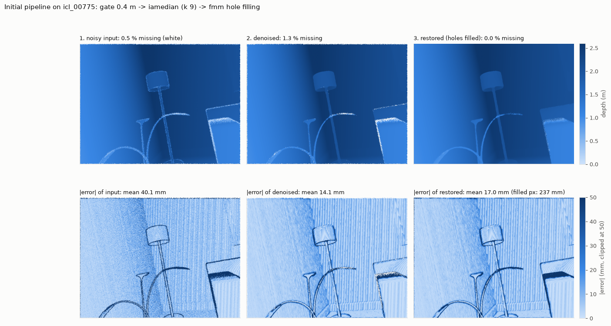
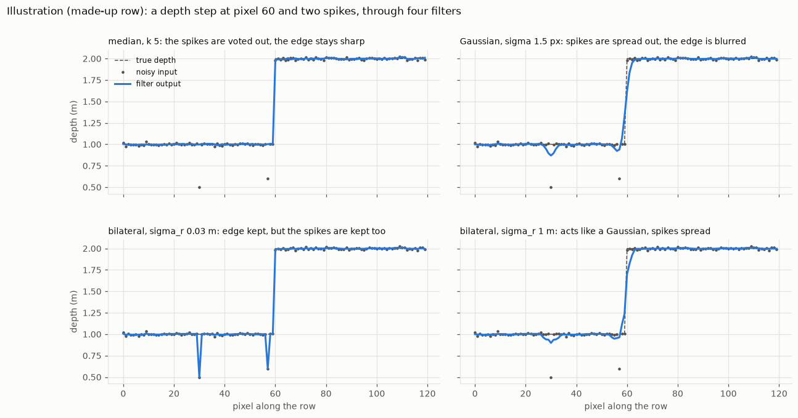
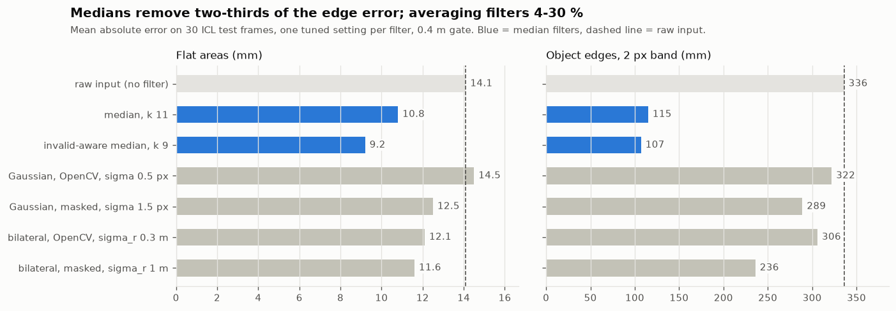
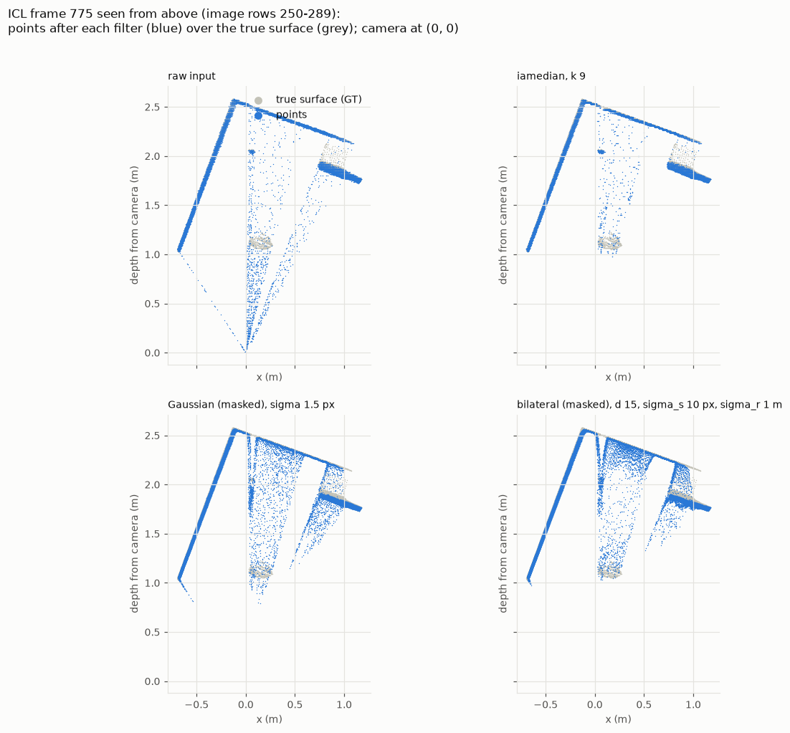
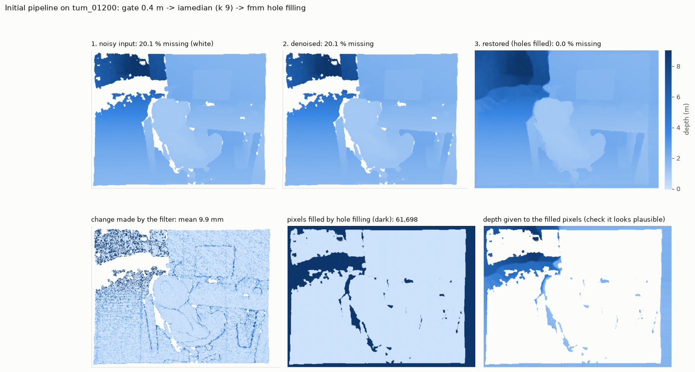

# Kinect Lite: cleaning up depth images

Depth cameras like the Kinect measure how far away every pixel is. The result is noisy: some distances are
wrong, and some pixels have no distance at all (holes). This project cleans those depth images with
simple image filters, then fills the holes.

<p align="center"></p>

**What you see:** one frame of a living room (a lamp, a plant and a sofa).
The top row is the depth image at each step; lighter blue means closer, darker blue means farther, white
means no data. The bottom row shows how wrong each step is compared with the true depth: light = almost
right, dark blue = 5 cm or more off.

**What it tells you:** the noisy input (left) is speckled with errors everywhere. After denoising (middle) most
of the speckle is gone and the error drops from 40 mm to 14 mm on average. After filling the holes (right)
the image is complete; the error rises a little (17 mm), because the filled pixels are guesses.


## The pipeline in three steps

```
 noisy depth image
        |
   1. remove impossible values     anything closer than 0.4 m is a sensor error, so it is deleted
        |
   2. denoise                       each pixel takes the median of its neighbours: spikes disappear
        |
   3. fill the holes                missing pixels are filled from the depth around them (inpainting)
        |
 restored depth image
```

That's all. **No AI model is trained**: these are classic image filters. We only chose their settings
(like the window size) by testing several values and keeping the best one.

Why a median? The noise in these images is mostly **spikes**: single pixels that are far too close.
A median ignores a spike; an average (like a Gaussian blur) smears it into its neighbours.

<p align="center"></p>

**What you see:** a made-up row of a depth image: a flat surface at 1 m that jumps to 2 m at pixel 60
(an object edge), with small noise and two spikes (the grey dots at 0.5 m and 0.6 m). The dashed line is
the truth, the blue line is what each filter makes of it.

**What it tells you:** the **median** (top left) removes both spikes and keeps the edge sharp. The
**Gaussian** (top right) cannot remove a spike; it smears it into a dip and also softens the edge. The
**bilateral** with a strict setting (bottom left) keeps the edge but also keeps the spikes; with a loose
setting (bottom right) it behaves like a Gaussian.


## Results

On 1,509 test frames with known true depth (the ICL-NUIM dataset), the pipeline cut the average depth error
**from 34.7 mm to 13.0 mm**, and it improved **every single frame**.

<p align="center"></p>

**What you see:** the average error of each filter, measured on 30 test frames. Left: flat surfaces such as
walls. Right: the thin band around object edges. The dashed line is the unfiltered input; shorter bars are
better. The blue bars are the two median filters.

**What it tells you:** on flat surfaces every filter except the OpenCV Gaussian helps a little (14.1 mm down
to 9-12.5 mm). At edges the difference is large: the medians cut the error from 336 mm to about 110 mm,
while Gaussian and bilateral filters only reach 236-322 mm. That is the spikes again: they sit at edges.

The same thing in 3D:

<p align="center"></p>

**What you see:** a horizontal slice of the room seen from above, as if looking down from the ceiling. The
camera sits at the bottom (0, 0). Grey is the true surface: two walls meeting in a corner, small objects in
front of them (the plant and the lamp stand), and the sofa on the right. Blue are the measured points.

**What it tells you:** in the raw input (top left) many points float in front of the objects, on straight
lines running from the camera toward those objects. Those are the spikes: depth values that are too
close. The median (top right) removes almost all of them. The Gaussian and bilateral (bottom) cannot remove
them and instead spread them into fans behind the objects.

On a real camera:

<p align="center"></p>

**What you see:** one frame from a real camera (the TUM dataset, an Asus Xtion) looking at a desk with a
monitor and a chair with a teddy bear. Top row: the input, after denoising and after hole filling; white is
missing data. Bottom row: how much the filter changed each pixel, which pixels were filled (dark), and the
depth given to those filled pixels.

**What it tells you:** a real camera misses far more than the simulation: 20 % of this frame is empty,
mostly a large band at the far upper left and thin strips beside the chair. Hole filling closes all of it
by extending the surrounding depth inward. There is no true depth for real recordings, so these fills can
only be checked by eye; they look plausible, but they are guesses.


## Try it

You need Python 3.10 or newer. A few sample frames are included, so you don't need to download anything.

```
python -m venv .venv
.venv\Scripts\activate          # on Linux / macOS: source .venv/bin/activate
pip install -r requirements.txt

python denoise/process.py --input samples/tum/depth
```

Then open `outputs/process/depth/`:

| file | what it is |
|---|---|
| `preview.mp4` | a video: noisy, denoised and restored side by side |
| `stages.png` | every step of one frame |
| `viewer_3d.html` | open in a browser and rotate the 3D point cloud |
| `restored/` | the cleaned depth images |

### Your own data

```
python denoise/process.py --input my_frame.png                       # one depth image
python denoise/process.py --input my_folder                          # a folder of depth images
python denoise/process.py --input my_video.avi --video-max-depth 5   # a depth video
```

Depth images should be 16-bit PNGs where value / 5000 = metres and 0 = no data (the format of the TUM and
ICL-NUIM datasets). To try other methods, add `--filter` (for example `median` or `bilateral_cv2`) or
`--fill` (`fmm`, `ns` or `none`).


## What's in this repository

| folder | contents |
|---|---|
| `denoise/` | the code |
| `samples/` | a few depth frames and a short depth video to try it on |
| `RESULTS/` | the main pictures, a results table and two 3D viewers |
| `outputs/` | all measured numbers and every figure |
| `experiments/` | the test setups that were run |
| `docs/` | [`PIPELINE.md`](docs/PIPELINE.md): method and all results · [`PROGRESS_REPORT.md`](docs/PROGRESS_REPORT.md): progress update · [`REFERENCES.md`](docs/REFERENCES.md) |


## Limits

- The test data with known true depth is **simulated**. Real cameras may behave a bit differently.
- **Filled pixels are guesses.** They are much less accurate than measured ones (about 13 cm off on average).
- Each frame is cleaned on its own; neighbouring frames are not used.
- It takes about 0.35 s per frame in Python, so it is not real-time yet.


## Project status

**Phase 1, cleaning the depth images: done.** The full method and every result are in
[`docs/PIPELINE.md`](docs/PIPELINE.md); the latest progress update is [`docs/PROGRESS_REPORT.md`](docs/PROGRESS_REPORT.md).

We also tried **temporal filtering** (averaging several aligned frames). It did not help: the results stayed
about the same as with spatial filtering alone, and were worse in some cases. So we dropped it and kept only
the spatial pipeline.

**Phase 2, ICP: next.** Use the cleaned depth images to track how the camera moves, and check against the
camera's known path in the TUM dataset whether cleaning makes tracking more accurate.


<details>
<summary><b>For developers: rerun the full study</b></summary>

Download the datasets and place them next to `denoise/`:

- ICL-NUIM living room kt0 (noisy and noise-free depth): https://www.doc.ic.ac.uk/~ahanda/VaFRIC/iclnuim.html
  → `ICL NUIM/lr_kt0_noisy/depth/`, `ICL NUIM/lr_kt0_noisefree/depth/`
- TUM RGB-D fr3 long_office_household: https://cvg.cit.tum.de/data/datasets/rgbd-dataset
  → `RGB TUM/rgbd_dataset_freiburg3_long_office_household/`

Then:

```
python denoise/audit.py                                   # checks on the data
python denoise/audit2.py
sh denoise/run_tuning.sh                                   # try every filter setting (about 1 hour)
python denoise/select_configs.py                           # keep the best setting per filter
python denoise/run.py experiments/eval_selected.json --save-frames 275,775,1225
python denoise/run.py experiments/tum_selected.json
python denoise/run.py experiments/pipeline_icl.json
python denoise/run.py experiments/pipeline_tum.json
python denoise/plots.py tuning
python denoise/plots.py eval
python denoise/plots.py tum
python denoise/pointcloud.py
python denoise/illustrate.py
python denoise/pipeline.py --icl 775 --figure
python denoise/pipeline.py --tum 1200 --figure
python denoise/make_results.py                             # rebuild RESULTS/
python denoise/process.py --dataset icl --frames 0:1509:1 --no-pngs --video-scale 0.5
```

How the experiments work is explained in `experiments/README.md`. Settings were chosen on frames
0, 50, 100 ... and tested on frames 25, 75, 125 ..., so the results were not tuned on the frames they were scored on.

</details>


## Credits

Datasets: ICL-NUIM (Handa et al., ICRA 2014) and TUM RGB-D (Sturm et al., IROS 2012). Full references in
[`docs/REFERENCES.md`](docs/REFERENCES.md).
