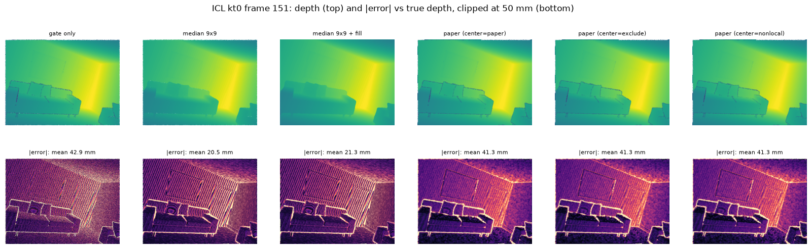
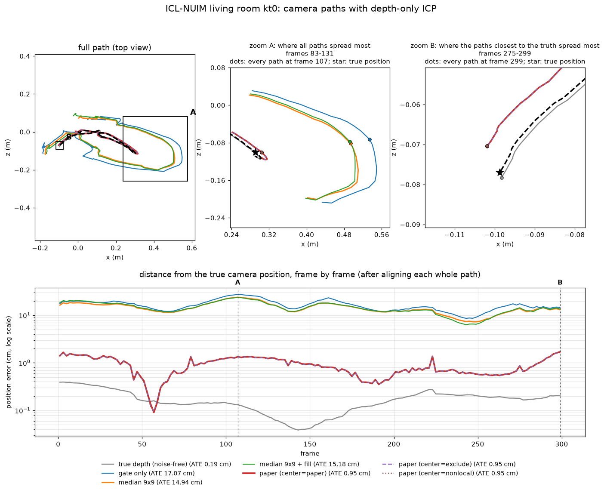

# Kinect Lite: depth denoising for camera tracking

A Kinect-type camera gives a distance for every pixel, but the depth image has two kinds of errors:
spikes (pixels with a very wrong distance) and holes (pixels with no distance).
In this project we clean the depth images and check if the cleaning makes camera tracking (depth-only ICP) more accurate.

## Short summary

- Depth error: a simple 9x9 median filter halves the depth error (MAE 39 mm to 19 mm on ICL). The paper's filter barely changes it.
- Camera tracking: the paper's method (Fu et al.) drifts 4 to 16 times less than our median (ATE 0.95 cm vs 14.94 cm on ICL, 3.33 cm vs 13.32 cm on TUM).
- So the cleaner with the smaller depth error is not the one that tracks better.

## The two cleaners

| method | code | what it does | time for 450 frames |
|---|---|---|---|
| Median 9x9 (ours) | `src/clean.py` | depth closer than 0.4 m becomes a hole, then every pixel gets the median of its 9x9 neighbours. One frame at a time. | under 1 min |
| Fu et al. 2012 (paper) | `src/paper_pipeline.py` | fills holes from the 2 frames before and after (block matching), then smooths with a spatial-temporal bilateral filter. | about 26 min |

Fu et al. is slow because for every pixel it searches 169 positions (a 13x13 window) in each of the 4 neighbouring frames,
comparing 9x9 blocks each time. That is roughly 16 billion operations per frame in Python on the CPU.
The ICP tracking itself is fast (about 0.3 s per frame).

The cleaned depth goes into a depth-only ICP tracker (Open3D point-to-plane, frame to frame, voxels 4/2/1 cm).
The estimated camera path is compared with the true path.

```
raw depth -> cleaner (none / median / Fu et al.) -> cleaned depth -> ICP -> camera path vs true path
```

## Data and metrics

| dataset | what it is | frames used | ground truth |
|---|---|---|---|
| ICL-NUIM living room kt0 | synthetic, with simulated Kinect noise | 1 to 300, every 2nd frame tracked (150) | true depth and true camera path |
| TUM RGB-D fr3 long_office_household | real sensor | 0 to 299, every 2nd frame tracked (150) | true camera path only |

| metric | meaning | better |
|---|---|---|
| MAE (mm) | average depth error per pixel | lower |
| RMSE (mm) | like MAE but big errors count more (a large RMSE means spikes are still there) | lower |
| within 1 cm | share of pixels within 1 cm of the true depth | higher |
| ATE (cm) | average distance between estimated and true camera position over the whole path (drift) | lower |
| RPE (mm) | error of one step between two tracked frames | lower |

## Results

### 1. Depth accuracy (ICL)

| method | MAE (mm) | RMSE (mm) | median error (mm) | within 1 cm |
|---|---|---|---|---|
| no cleaning | 39.2 | 187.5 | 13.3 | 42.2 % |
| median 9x9 | 18.8 | 55.4 | 12.3 | 44.7 % |
| Fu et al. | 37.7 | 186.0 | 13.4 | 33.7 % |

The ICL noise is mostly spikes. The median removes them. The bilateral filter of Fu et al. does not, because a spike is only
averaged with itself.



### 2. Camera tracking (depth-only ICP), ATE in cm / RPE in mm

| method | ICL | TUM |
|---|---|---|
| true depth (best possible) | 0.19 / 0.07 | - |
| no cleaning | 17.07 / 14.43 | 13.97 / 11.69 |
| median 9x9 | 14.94 / 11.78 | 13.32 / 10.86 |
| Fu et al. | 0.95 / 2.02 | 3.33 / 4.37 |

Fu et al. is clearly the best. The median is only a little better than no cleaning. Fu et al. has the worse depth error
(MAE 37.7 vs 18.8 mm) but tracks much better, because ICP needs two frames that agree with each other, not frames
that are each close to the truth.



### 3. Which ICP variant? (ATE cm / RPE mm)

| ICL | point-to-point | point-to-plane | point-to-plane + Tukey |
|---|---|---|---|
| true depth | 1.81 / 3.29 | 0.19 / 0.07 | 0.14 / 0.05 |
| no cleaning | 36.96 / 21.36 | 17.05 / 14.38 | 22.47 / 17.47 |
| median 9x9 | 28.50 / 19.72 | 14.94 / 11.78 | 19.24 / 14.11 |
| Fu et al. | 1.93 / 3.16 | 0.95 / 2.02 | 1.42 / 2.54 |

| TUM | point-to-point | point-to-plane | point-to-plane + Tukey |
|---|---|---|---|
| no cleaning | 27.24 / 14.92 | 13.97 / 11.69 | 14.31 / 11.55 |
| median 9x9 | 18.14 / 13.78 | 13.33 / 10.86 | 13.07 / 10.96 |
| Fu et al. | 5.31 / 5.21 | 3.33 / 4.37 | 3.21 / 4.23 |

- Point-to-plane is better than point-to-point in every row, so it is the one used for the main results.
- The Tukey loss does not help clearly.
- Generalized ICP gave unstable results (it diverged on the noisy data), so it is not in the table.
- Fu et al. beats the median with every ICP variant.

### 4. Why does the median not help ICP?

We checked the surface normals on 9 ICL frames (`experiments/normals_check/`):

| | normal error (median / mean) | disagreement between frames (median / bias) |
|---|---|---|
| no cleaning | 5.5 / 10.1 deg | 5.0 / 0.84 mm |
| median 9x9 | 2.8 / 7.4 deg | 3.6 / 1.09 mm |
| Fu et al. | 1.6 / 3.7 deg | 1.8 / 0.26 mm |

Fu et al. gives about twice as accurate normals and frames that agree about twice as well. The median leaves the biggest bias.
This is a small check (9 frames, ICL only) and shows a likely reason, not a proof.

### 5. Should the holes be filled?

We tried 8 ways to fill holes (`experiments/hole_filling/`). None improved tracking on ICL. Navier-Stokes helped
on TUM (12.03 vs 13.33 cm) but was worse on ICL (15.36 vs 14.94 cm), so we do not count it. Keeping the holes is fine.

## Conclusion

| goal | use | why |
|---|---|---|
| camera tracking (main goal) | Fu et al. | 4 to 16 times less drift, but slow (about 26 min for 450 frames) |
| only the depth error | 9x9 median | halves the error, under 1 min for 450 frames |

## Live demo

Folder `demo/`. It tracks the camera live with ICP for three inputs (no cleaning, median, Fu et al.) and shows the path,
the error per frame, ATE and RPE.

To run:
1. Double-click `demo/run_live_ui.bat`.
2. The browser opens http://127.0.0.1:8765/
3. Choose ICL living room, start frame 450, 60 frames, Accurate, and click "Start live run".
4. If something fails, click "Instant replay", or double-click `demo/open_dashboard.bat` to play the video.

Speed: about 2 frames per second (tracking only).
The depth cleaning is not done live (Fu et al. takes about a minute per frame). Frames 303 to 597 were cleaned
beforehand on Kaggle and saved in `demo/data/cache/icl`. These frames were not used for tuning.

The live numbers are a bit different from the table above because the demo uses frames 303 to 597, which are harder
than frames 1 to 300 of the report. On those frames with Fu et al.: ATE 2.35 cm when every frame is tracked, 1.80 cm
when every 2nd frame is tracked (the report setting).

More details are in `demo/README.txt`.

## How to run the experiments

```
pip install -r requirements.txt
python src/icl_compare.py --start 1 --frames 300 --step 2
python src/tum_compare.py --start 0 --frames 300 --step 2
python src/icp_variants.py --dataset both --frames 300 --step 2
python experiments/hole_filling/compare_fills.py --frames 300 --step 2
python experiments/normals_check/check_normals.py
```

The slow ones were run on Kaggle. The datasets are not included. Download them into this folder:
[ICL-NUIM](https://www.doc.ic.ac.uk/~ahanda/VaFRIC/iclnuim.html) (living room kt0) into `ICL NUIM/` and
[TUM RGB-D](https://cvg.cit.tum.de/data/datasets/rgbd-dataset) (fr3 long_office_household) into `RGB TUM/`.
All numbers are saved in `src/results/` and `experiments/*/results/`.

## Folders

| folder / file | contents |
|---|---|
| `src/` | main code: `clean.py` (median), `paper_pipeline.py` (Fu et al.), `icl_compare.py`, `tum_compare.py`, `icp_variants.py`, data loading, and `results/` |
| `experiments/` | hole filling, normals check, earlier filter study |
| `demo/` | live demo (see above) |
| `videos/` | demo video `video_demo_full.mp4` |
| `report_source/`, `Mini Project Report (ICP update).pdf` | the report |
| `Project_Explained.pdf` | study guide |

## Credits

J. Fu, S. Wang, Y. Lu, S. Li, W. Zeng, "Kinect-Like Depth Denoising," ISCAS 2012.
Datasets: ICL-NUIM (Handa et al., 2014), TUM RGB-D (Sturm et al., 2012).
Built with Open3D, OpenCV, NumPy, SciPy and Matplotlib.
