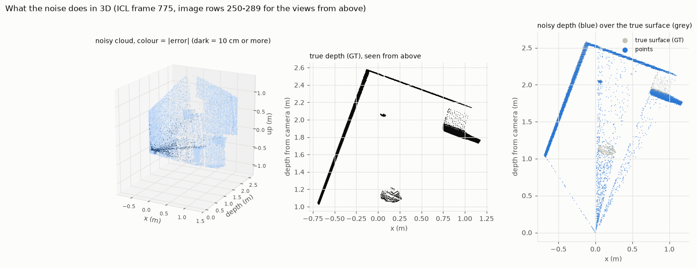
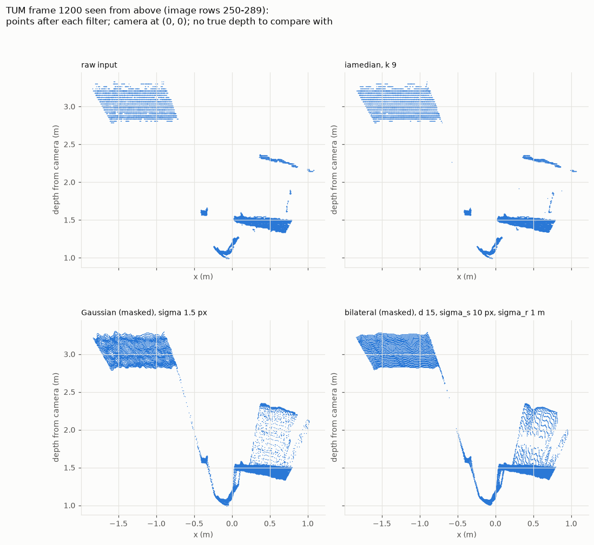

# The denoising pipeline: method and results

This page explains how the pipeline works, how it was tested, and what came out. For a quick overview, see the
main [README](../README.md); for the progress update, see [`PROGRESS_REPORT.md`](PROGRESS_REPORT.md).


## 1. The data

| dataset | what it is | why we use it |
|---|---|---|
| ICL-NUIM living room kt0 | 1,509 rendered depth frames with simulated sensor noise, plus the true depth of every pixel | every result can be checked against the truth |
| TUM RGB-D fr3 long_office_household | 2,509 real depth frames from an Asus Xtion (a Kinect-type sensor), plus the camera's true path | shows what happens on a real sensor |

Depth images are 16-bit PNGs: value / 5000 = metres, 0 = no measurement.


## 2. What the noise looks like

Before choosing filters, we compared the noisy ICL images with the true depth. Three things stood out:

- **4 % of the pixels carry 56 % of the error.** These are pixels on object edges and a few values that are far
  too close to the camera.
- **The edge errors are spikes, not blur.** Seen in 3D, the bad points sit on straight lines from the camera
  toward object edges: depth values that are too small, often by a metre.
- **The noisy and true images are about 1 pixel out of line.** This adds roughly 1.5 mm to every score and is
  the same for all filters.

<p align="center"></p>

*Left: the noisy point cloud, coloured by error. Right: a slice of the room seen from above. Grey is the true
surface, blue the noisy points; the camera is at (0, 0). The blue points floating in front of the objects are
the spikes.*


## 3. The pipeline

```
noisy depth  ->  1. gate  ->  2. denoise  ->  3. fill holes  ->  restored depth
```

| step | what it does | default | other options |
|---|---|---|---|
| 1. gate | deletes depth closer than 0.4 m (the sensor cannot measure it) | 0.4 m | any value, or off |
| 2. denoise | replaces each pixel using its neighbours | invalid-aware median, 9 x 9 window | median, Gaussian, bilateral |
| 3. fill holes | fills empty pixels from the depth around them | FMM inpainting | Navier-Stokes inpainting, region fill, none |

Notes on the choices:

- **Invalid-aware median:** the median of only the measured pixels in the window, so holes never count as 0 m and
  no measured pixel is deleted.
- **"Masked" Gaussian and bilateral:** OpenCV's versions treat holes as 0 m, which drags nearby depth toward the
  camera. Our masked versions leave holes out of the average.
- **Filled values are clipped** to the depth range around each hole, because FMM can overshoot.

No model is trained. The only data-driven part is choosing each filter's settings (section 4).


## 4. How the filters were tested

- **Tuning and test frames are separate.** Settings were tried on frames 0, 50, 100 ... (31 frames); the best
  setting of each filter was then scored once on frames 25, 75, 125 ... (30 frames).
- **Flat areas and edges are scored separately**, because a single average hides where a filter helps or hurts.
  Edges are found in the true depth, so a filter cannot move them.
- **All filters are scored on the same pixels**, so filling or deleting pixels cannot change a score.
- **Error** = mean absolute difference from the true depth, in mm.

Every experiment is a small recipe file in [`../experiments/`](../experiments/README.md).


## 5. Results: which filter

<p align="center"></p>

| filter (best setting, 0.4 m gate) | all pixels (mm) | flat areas (mm) | edges (mm) |
|---|---|---|---|
| no filter | 26.2 | 14.1 | 336 |
| median, 11 x 11 | 14.8 | 10.8 | 115 |
| **invalid-aware median, 9 x 9** | **12.8** | **9.2** | **107** |
| Gaussian (OpenCV), sigma 0.5 px | 26.1 | 14.5 | 322 |
| Gaussian (masked), sigma 1.5 px | 23.7 | 12.5 | 289 |
| bilateral (OpenCV) | 23.4 | 12.1 | 306 |
| bilateral (masked) | 21.5 | 11.6 | 236 |

*30 ICL test frames.*

**Why the median wins:** a median ignores a spike; an average spreads it. The figure below shows this on a
made-up row with an edge and two spikes.

<p align="center"></p>

**What it costs:** medians shift object outlines by a pixel or two. Pixels on the wrong side of an edge rose
from 8.6 % to about 20 %.

**Missing pixels matter as much as the filter:** the OpenCV Gaussian (holes counted as 0 m) is *worse* than no
filter on flat areas, while the masked Gaussian is better.


## 6. Results: hole filling

After the invalid-aware median, about 49,000 pixels in the 30 test frames are still empty. How well each method
fills them:

| fill method | pixels filled | mean error of the filled pixels |
|---|---|---|
| region fill (small holes only) | 1,390 | 60 mm |
| FMM, holes up to 1,024 px | 44,026 | 74 mm |
| FMM, all holes (default) | 49,328 | 130 mm |
| Navier-Stokes, all holes | 49,328 | 33 mm |

Filled pixels are much less accurate than measured ones, because most holes sit on object edges. Navier-Stokes
filled the same holes about four times more accurately than FMM; `--fill ns` switches to it.


## 7. The whole pipeline on every frame

| | ICL-NUIM, 1,509 frames | TUM, 2,509 frames |
|---|---|---|
| mean error: noisy input | 34.7 mm | (no true depth) |
| mean error: after denoising | 13.0 mm, lower on every frame | - |
| mean error: restored, incl. filled pixels | 14.6 mm | - |
| missing pixels: input -> restored | 0.5 % -> 0 % | 16.6 % -> 0 % |
| time per frame | 0.34 s | 0.40 s |

<p align="center"></p>

*One ICL frame through the pipeline. Top: depth at each step (white = no data). Bottom: error against the
true depth (dark = 5 cm or more).*

<p align="center"></p>

*One real TUM frame. Top: depth at each step. Bottom: what the filter changed, which pixels were filled
(dark), and the depth given to them.*


## 8. Real data (TUM)

Without true depth, TUM shows only what each filter changes:

- the bilateral and masked Gaussian make flat surfaces 8-11 times smoother; the medians about 1.3 times;
- but they also create stray points between objects (for example between a desk and the wall behind it);
- the 0.4 m gate does nothing on TUM, which has no depth that close.

<p align="center"></p>

*A real frame seen from above after each filter. The Gaussian and bilateral fill the empty gap between the desk
(1.5 m) and the wall (2.3 m) with points that are not really there.*

Which filter is best on real data will be measured through ICP (section 10).


## 9. Limits

- ICL's noise is simulated; its edge spikes likely come from how the noise was simulated, which favours the median.
- Filled pixels are estimates (33-130 mm off on ICL, depending on the method).
- Each frame is cleaned on its own. Temporal filtering (averaging aligned frames) was tried and dropped: it did
  not improve on spatial filtering, and was worse in some cases.
- About 0.35 s per frame in Python: not real-time.


## 10. Next: ICP

ICP aligns the point clouds of two frames to find how the camera moved. TUM records the camera's true path, so
comparing the paths estimated from raw, denoised and restored depth will show whether cleaning helps on a real
sensor.
